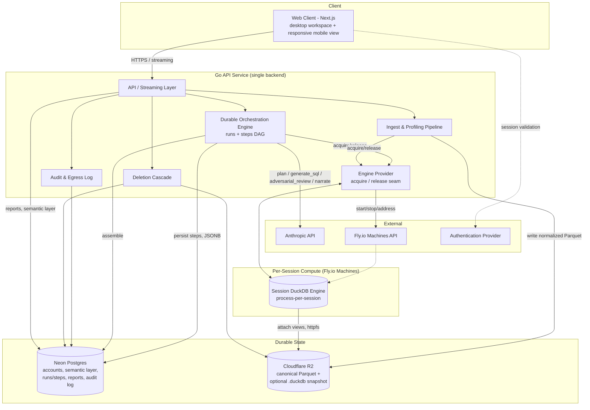
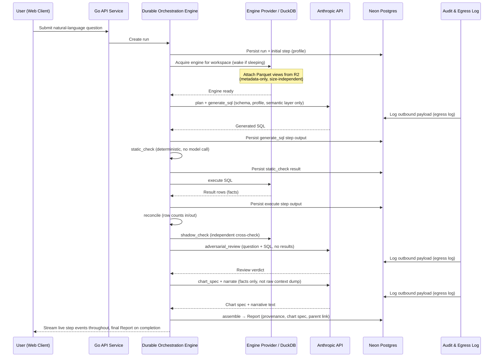

# Architecture

**Last Updated:** 2026-08-05
**Source:** [[README]], [[branding]], [[features]]

## Architecture Overview

**Platform:** `Web`, with a responsive mobile view *(copied verbatim from [[branding]] Section 1 — Target Platform. Desktop is the primary workspace for SQL editing, ingest confirmation, and export; mobile is a first-class viewing surface, not a re-decided platform.)*
**Architecture Style:** Client-Server with a single custom backend orchestrator — not microservices. One backend service owns the API, the durable workflow engine, and all engine access; the frontend is a thin, streaming presentation layer.
**Primary Client:** Browser (SPA-like client-heavy surfaces for the workspace/run-viewer/report UI, with SSR/SSG limited to marketing, auth, and the static shell).
**Hosting Model:** Cloud, multi-vendor Platform-as-a-Service — Fly.io (compute), Neon (managed Postgres), Cloudflare R2 (object storage). No self-hosted infrastructure, matching the Cloud SaaS-only deployment model in [[README]].

Groundwork is a single Go backend service (the only backend — see the Boundary Rule below) fronted by a Next.js application, with a per-workspace disposable DuckDB engine process spun up on demand. All durable state — accounts, workspaces, the semantic layer, run/step state, reports, and the audit/egress log — lives in one Postgres database. Canonical data lives in object storage as Parquet; the DuckDB engine is a disposable, rebuildable compute layer over it, never the system of record.

## System Components

### Component: Web Client (Next.js)

**Responsibility:** Renders the UI and handles user interaction — ingest confirmation, question input, the live run viewer, report reading, SQL editing, and export triggers.
**Provides:** Screen rendering, client-side navigation, streaming display of live run events, responsive layout for the desktop workspace and mobile report-viewing surfaces defined in [[branding]].
**Consumes:** The Go API Service (all data and actions), an authentication provider (session handling).
**Platform Notes:**
- Web: SSR/SSG is used only for the marketing site, auth pages, and static shell. The workspace, run-viewer, and report surfaces are client-side and stream from the Go API Service directly — server rendering earns little on surfaces that are inherently live and interactive.
- Mobile view: the same web client, responsively adapted — not a separate native app. Ingest and SQL-editing flows may remain desktop-oriented, but reports, charts, and provenance links must render fully on a mobile viewport per [[features]] FEAT-041.
- **Boundary rule:** the Next.js layer is permitted to do rendering, routing, auth-session handling, and BFF-style proxying to the Go API Service. It must never accumulate run orchestration, engine access, semantic-layer mutation, or any DuckDB access — that would split the single orchestrator's guarantees (persisted step state, idempotent retries, runs surviving disconnect) across two languages and two deployment lifecycles.

### Component: Go API Service

**Responsibility:** The single backend. Owns the HTTP/streaming API, user and workspace management, the durable orchestration engine, all engine (DuckDB) access, and all outbound calls to the AI provider.
**Provides:** Account/workspace endpoints, file ingest handling, the run/step orchestration API, live run event streams, report read/export endpoints, the audit/egress log, workspace deletion, and password reset token issuance ([[features]] FEAT-001).
**Consumes:** Neon Postgres (all durable state), Cloudflare R2 (object storage), the Engine Provider component (DuckDB access), the Anthropic API (model calls), a Transactional Email Provider (password reset link delivery).
**Platform Notes:**
- Chosen for process supervision, long-running jobs, streaming events, concurrent runs, and cancellation — these map naturally onto Go's concurrency and context-cancellation primitives, which is the actual hard part of the interruptible pipeline (see [[features]] FEAT-022–024).
- The DuckDB driver is the official `duckdb/duckdb-go` (cgo-based). Builds require `CGO_ENABLED=1` and a C compiler; fully static binaries are not available. This is an accepted, documented constraint, not an oversight — see [[risk_log]] (R-010).
- Uses the official Anthropic Go SDK for all model calls — no second language is introduced for the AI layer.
- Password reset requests always create a `PasswordResetToken` row (per [[schema]]) and return an identical response whether or not the submitted email matches an account — the service never branches its response on account existence. Tokens are single-use and expire 30 minutes after issuance; delivery is a fire-and-forget request to the Transactional Email Provider rather than a step the reset-request flow blocks on.

### Component: Durable Orchestration Engine (in Go API Service, backed by Postgres)

**Responsibility:** Executes every run as a persisted, resumable directed graph of steps (profile → plan → generate_sql → static_check → execute → reconcile → shadow_check → adversarial_review → chart_spec → narrate → assemble), and supports halting, amending, resuming, and forking any run.
**Provides:** `runs` and `steps` rows in Postgres with `parent_step_id` for forks; step state persisted as JSONB at every boundary; idempotent, retryable step execution; live and durable event emission.
**Consumes:** Neon Postgres (`runs`/`steps` tables, `SELECT ... FOR UPDATE SKIP LOCKED` for work claiming, `LISTEN`/`NOTIFY` for wakeup), the Engine Provider (to execute `generate_sql`/`execute`/`shadow_check` steps against a live DuckDB engine), the Anthropic API (for `plan`, `generate_sql`, `adversarial_review`, and `narrate` steps).
**Platform Notes:**
- Built hand-rolled on Postgres rather than adopting Temporal, deliberately: Temporal workers require continuously running compute (long-polling), which breaks the scale-to-zero cost model this product depends on at pre-revenue scale; step state is product data (provenance, determinism caching) that must join directly against workspaces, reports, and the audit log, which would otherwise require mirroring Temporal's store into Postgres anyway; and fork-on-amendment — the core primitive behind [[features]] FEAT-025 and the compositional conversation loop (FEAT-021) — is a branching-DAG operation that Temporal's linear-workflow-with-reset model does not represent naturally.
- Required correctness pieces, all on the `runs`/`steps` schema: leases with heartbeats (a worker holds a step and renews it; death reclaims it — the commonly-skipped piece that produces stuck jobs), idempotency keys per step so retries cannot double-execute, and retry counts/backoff stored on the row.
- Work is claimed via `LISTEN`/`NOTIFY` for near-immediate wakeup, with a slow safety-net poll to catch missed notifications. The orchestrator never tight-polls Postgres — that would keep Neon's serverless compute permanently awake and burn CU-hours, defeating the scale-to-zero database choice below.
- Because every step boundary is persisted, interruption, amendment, provenance (claim → cell → query → rows), and determinism caching all fall out of reading/writing this one schema rather than being separately built features.

### Component: Engine Provider

**Responsibility:** Abstracts "get me a live DuckDB engine for this workspace" behind a stable seam (`acquire(workspace_id) → EngineHandle`, `release(handle)`), independent of how that engine is currently provisioned.
**Provides:** A handle to a running, addressable DuckDB engine process for a given workspace, hiding whether that process is freshly spawned, drawn from a future warm pool, or (later) a remote machine.
**Consumes:** The Fly.io Machines API (to start/stop/address a per-session engine process), Cloudflare R2 (to attach Parquet views on wake), optionally a `.duckdb` snapshot if one exists (see Data Architecture).
**Platform Notes:**
- Local, one-OS-process-per-active-session is implementation #1 of this seam. A warm pool of pre-started processes is a deferred implementation #2 (see [[roadmap]] — not scheduled until a single machine can no longer hold concurrent sessions, or provisioning latency is measured and found to matter). Neither the Durable Orchestration Engine nor any other component is aware of which implementation is active — this is what makes warm pooling a contained future change instead of a rewrite.
- Process-per-session gives genuine tenant isolation: each workspace's engine runs in a separate address space, which is a real architectural safeguard behind [[README]]'s privacy differentiator, not just a performance choice.
- Fly.io was chosen over Cloud Run specifically for this component. Cloud Run's session affinity is a best-effort, cookie-based routing *hint* — a request may be served by a different instance if the affinity target can't serve it, silently producing a cold rebuild or missing state. That is disqualifying because the engine holds live, in-memory state (attached views, derived tables, materialized joins) that must be reliably reached at the same process. Fly Machines have stable IDs, and `fly-replay` targets one specific machine deterministically.

### Component: Ingest & Profiling Pipeline

**Responsibility:** Turns an uploaded file into normalized, profiled, joinable data ready for querying, and drives the mandatory ingest-confirmation round trip with the user.
**Provides:** Type-inferred, normalized Parquet output written to object storage; per-column profiling statistics; PII flags; candidate joins with confidence scores.
**Consumes:** The uploaded file (from the Web Client via the Go API Service), a live DuckDB engine (via the Engine Provider) to perform ingest and profiling, Cloudflare R2 (to write normalized Parquet).
**Platform Notes:**
- Stores the ingested and normalized Parquet, never the original CSV/Excel file, as the durable artifact — re-parsing a messy source file on every rebuild is both slower and a correctness risk (type inference could differ between rebuilds).
- Relationship inference (name similarity, type compatibility, value overlap sampling, cardinality checks) runs as part of this pipeline whenever 2+ files are uploaded, producing candidates that are never auto-applied — see [[features]] FEAT-008/FEAT-009.
- Ingesting Excel or SQLite requires a DuckDB extension (`excel`, `sqlite_scanner`) that is fetched at runtime from `extensions.duckdb.org` on first use unless preinstalled. This is an accepted, documented runtime network dependency, not an oversight — see [[risk_log]] R-017 and the Deployment Topology note below. CSV and Parquet ingest have no such dependency.

### Component: Semantic Layer Store

**Responsibility:** Persists everything true about a workspace's data that isn't recoverable from schema alone — confirmed relationships, grain, metric definitions, business meaning, and accumulated user corrections.
**Provides:** Grounding context supplied to every model call in the Durable Orchestration Engine's `plan` and `generate_sql` steps.
**Consumes:** Confirmed ingest decisions (from the Ingest & Profiling Pipeline round trip), user corrections made via SQL edits (from the Durable Orchestration Engine's amend/resume path).
**Platform Notes:**
- Lives entirely in Neon Postgres as rows keyed to the workspace — not inside any DuckDB file — specifically so it is portable, versionable, and re-appliable to a rebuilt engine, and so a `.duckdb` snapshot remains a pure, discardable performance optimization rather than a store of anything that can't be lost.

### Component: Report Store

**Responsibility:** Stores completed runs as first-class, versioned Report objects — not chat scrollback.
**Provides:** A stable, shareable, re-runnable Report object per completed run, carrying its provenance links, chart spec, and parent-report reference if forked.
**Consumes:** Assembled output from the Durable Orchestration Engine's final `assemble` step.
**Platform Notes:**
- Lives in Neon Postgres, independent of the DuckDB engine's lifecycle — a Report is fully readable, browsable, and exportable while its workspace's engine is asleep, which is what makes a sleeping workspace still fully usable (see [[README]] §7.11 in the source spec).

### Component: Audit & Egress Log

**Responsibility:** Records every payload sent to the model, every query, every export, and every deletion — a single object serving as both the model-egress log and the general audit log.
**Provides:** A queryable, user-viewable log of what left the trust boundary and when, per [[features]] FEAT-042.
**Consumes:** Write events from every other backend component that touches the model, exports data, or deletes state.
**Platform Notes:**
- Deliberately implemented once, not as two separate systems — the source spec is explicit that the audit log and the model-egress log describe one object.

### Component: Deletion Cascade

**Responsibility:** Executes the one-workspace-one-delete guarantee — a single operation that destroys object store contents, the semantic layer, profiling statistics, query caches, reports, conversation history, and logs for a workspace.
**Provides:** Provable deletion — a record of what was deleted and when, shown to the user.
**Consumes:** Every data store above, each of which tags its rows/objects with a workspace ID so the cascade has a single, reliable key to delete against.
**Platform Notes:**
- This is why every component above is described as keying its state to `workspace_id` — deletion correctness depends on that discipline being followed everywhere, not on the Deletion Cascade component alone.

## Data Architecture

### Data Stores

| Store | Type | What It Holds | Access Pattern |
|---|---|---|---|
| Neon Postgres (app database) | Relational, serverless (scales to zero after ~5 min idle) | Accounts, workspaces, semantic layer, `runs`/`steps` orchestration state, reports, audit/egress log | Read-heavy on reports and semantic layer; write-heavy, low-latency on `runs`/`steps` during an active run |
| Cloudflare R2 (object store) | S3-compatible object storage | Canonical normalized Parquet per workspace; optional `.duckdb` warm-cache snapshots | Write-once-per-ingest, read-many (Parquet); whole-file pull on resume (snapshot) |
| Session DuckDB engine | Embedded analytical database, disposable | Attached Parquet views, derived tables, materialized joins for the current session only | Ephemeral — rebuilt from R2 on wake, killed after ~10 min idle |

### Data Flow Patterns

- **Synchronous (ingest & ask):** Web Client → Go API Service → Engine Provider (acquire engine) / Ingest Pipeline / Durable Orchestration Engine, with results streamed back as they become available rather than returned in one blocking response.
- **Streaming (live run events):** Each step boundary written to `steps` in Postgres also emits a live event over a persistent connection to the Web Client, so the run viewer reflects progress in real time without polling.
- **Asynchronous (durable notifications):** A low-frequency, persisted notification (export ready, engine slept, ingest failed) is written separately from the high-frequency live event stream, deliberately using a different code path so the durable notification store doesn't fill with step-level noise — see [[features]] FEAT-026.
- **External egress (model calls):** Any payload leaving the Go API Service toward the Anthropic API is schema/profile/aggregate metadata by default, never raw rows, and is written to the Audit & Egress Log at the moment it is sent — the log entry and the outbound call are part of the same code path, not reconciled after the fact. Exclusion of any `pii_flag`-ed or `excluded_from_model` column's values (per [[features]] FEAT-007/FEAT-010) is enforced by one shared payload-construction function used by every model-calling step (`plan`, `generate_sql`, `adversarial_review`, `narrate`) — never per-step ad hoc filtering — specifically so the rule in [[features]] FEAT-013 cannot be silently bypassed by a future step that forgets to filter. See [[risk_log]] R-016 for the risk this seam closes.
- **Rebuild-on-wake:** Waking a workspace attaches Parquet views from R2 (metadata-only, independent of dataset size) and, if a valid `.duckdb` snapshot exists and opens successfully, warms from it; if the snapshot is missing or fails to open (e.g., a storage-version mismatch), the engine falls back to Parquet views automatically and silently, with no user-visible failure.

## External Integrations

| Service | Purpose | Direction | Criticality |
|---|---|---|---|
| Anthropic API | All model calls — query planning, SQL generation, adversarial review, narration | Outbound (API calls, via the official Go SDK) | High — the product cannot answer a question without it |
| Fly.io Machines API | Starts, stops, and addresses per-session DuckDB engine processes | Outbound (API calls, from the Engine Provider) | High — no query can execute without a reachable engine |
| Cloudflare R2 | Canonical Parquet storage and optional `.duckdb` snapshot storage | Outbound (S3-compatible API, `httpfs` from DuckDB) | High — the system of record for all ingested data |
| Neon (Postgres) | App database and durable orchestration state | Outbound (standard Postgres protocol) | High — the system of record for everything that isn't raw data |
| Authentication provider | User sign-in/session handling | Inbound (auth callback) / session validation | High — gates all access to workspace data |
| Transactional Email Provider | Delivers password reset links ([[features]] FEAT-001); the only outbound email the product sends today | Outbound (API calls, from the Go API Service) | Medium — account recovery is blocked without it, but no other flow depends on it |
| DuckDB Extension Repository (`extensions.duckdb.org`) | Runtime `INSTALL` of the `excel`/`sqlite_scanner` extensions on first Excel/SQLite ingest, unless preinstalled at image build time | Outbound (HTTPS fetch, from the Ingest & Profiling Pipeline via the Engine Provider) | Medium — required only for Excel/SQLite ingest; CSV/Parquet ingest is unaffected. Mitigated by preinstalling these extensions into the production container image rather than relying on this runtime fetch — see [[risk_log]] R-017 |

Chosen as a transactional-only email API (e.g., Resend or Postmark-class provider) rather than a general marketing-email platform, matching the product's existing bias toward focused, single-purpose vendors (see Fly.io/Neon/R2 above) over a heavier platform that brings capability the product doesn't use.

No live connections to user production databases are made — file-based OLTP (SQLite and similar) is ingested as an uploaded file through the same Ingest & Profiling Pipeline as CSV/Excel/Parquet, not through a separate integration, per [[README]]'s explicit non-goal on live OLTP connectivity.

## Deployment Topology

### Environments

| Environment | Purpose | Data |
|---|---|---|
| Development | Active development and integration testing | Synthetic/sample data, freely reset workspaces |
| Staging | Pre-release validation | Small set of realistic, non-sensitive sample workspaces |
| Production | Live user traffic | Real user data, subject to the deletion cascade and audit logging described above |

### Regions

Single-region to start, chosen to co-locate the Fly.io Machines, Neon Postgres, and Cloudflare R2 bucket for lowest latency between the engine and its object storage. Multi-region is not required at current scale and is not part of the near-term plan — see [[README]]'s pre-revenue cost discipline.

The production container image must preinstall the DuckDB `excel` and `sqlite_scanner` extensions at build time rather than relying on the runtime `INSTALL` fetch from `extensions.duckdb.org` that works in local development — a locked-down production network with no egress to that host would otherwise fail the *first* Excel or SQLite upload with no prior warning. See [[risk_log]] R-017.

### Scaling Strategy

Primarily scale-to-zero, not horizontal auto-scaling, because the dominant cost driver at this stage is idle infrastructure, not request throughput:

- **Compute (Fly.io Machines):** auto-stop/auto-start per session. A stopped machine bills only for its root filesystem (~$0.15/GB-month) — no CPU or RAM cost while idle. Per-second billing on running machines. This deliberately trades a higher per-second cost under sustained load for zero cost at zero usage; revisiting that trade-off is explicitly deferred until real usage data exists.
- **Database (Neon):** serverless Postgres, scales to zero after ~5 minutes idle, free tier at launch. The orchestration engine's `LISTEN`/`NOTIFY`-plus-safety-net-poll design exists specifically to avoid defeating this scale-to-zero behavior with a tight polling loop.
- **Object storage (R2):** inherently pay-per-use with zero egress fees, which matters here because the architecture reads Parquet over the network on every engine wake and rebuild — on egress-billed storage this would be a real and unpredictable recurring cost.
- **Future scaling lever (deferred):** a warm pool of pre-started Fly Machines, shared across all workspaces, is the identified path to sub-second wake once provisioning latency (not data loading — see below) becomes the bottleneck. Because the Engine Provider seam already abstracts engine acquisition, introducing a warm pool is a policy change (start N machines instead of 0) behind that same seam, not an architectural rewrite. Not built until one of the triggers in [[roadmap]]/the source spec is actually observed.
- **Known-wrong intuition worth flagging:** engine wake latency is dominated by compute provisioning, not by dataset size — attaching Parquet views is a metadata-only operation, so a 5GB dataset wakes about as fast as a 50MB one. The architecture deliberately does not materialize data on wake for this reason; it attaches views lazily and lets the first query pull only what it touches.

## Cross-Cutting Concerns

**Authentication & Authorization:** Standard account-based authentication (see [[features]] FEAT-001), handled at the Next.js layer for session management and enforced on every request by the Go API Service. Authorization is workspace-scoped: a user (or an invited read-only member, per [[features]] FEAT-045) can only access workspaces they own or have been explicitly granted access to. Read-only collaborators are enforced at the API layer, not just hidden in the UI — a read-only session cannot mutate the semantic layer or trigger new runs regardless of what the client sends.

Password reset (per [[features]] FEAT-001, screens [[screens/18-forgot-password|Forgot Password]] and [[screens/19-reset-password|Reset Password]]) is deliberately account-scoped, not workspace-scoped — it happens before any workspace is in context. Reset tokens are persisted as `PasswordResetToken` rows in Neon Postgres (per [[schema]]), not held in process memory, so a reset link keeps working across a restart or across multiple running instances of the Go API Service. Two security properties hold regardless of implementation details: the reset-request response never reveals whether the submitted email matches an account, and a token is single-use and time-bound (30-minute expiry), enforced server-side at consumption time.

**Error Handling:** Distinguishes run failures from workspace failures deliberately — a failed run (e.g., a transient engine loss mid-execution) surfaces a retry affordance scoped to that run, while the user's workspace, data, and existing reports remain visibly untouched. Snapshot-open failures fall back to Parquet views automatically and silently rather than surfacing an error. Transient infrastructure failures (e.g., a Fly Machine failing to start) are retried transparently before ever reaching the user, relying on the idempotent step design in the Durable Orchestration Engine.

**Logging & Monitoring:** Engine-seconds, object-store bytes, and model tokens are metered per workspace from day one (see [[features]] FEAT-047 for the user-facing view), independent of whether billing exists yet — this is what makes the idle-teardown threshold and cost model tunable from real data rather than guesswork. The Audit & Egress Log component doubles as the user-facing half of this observability; operational monitoring (uptime, error rates, queue depth on the orchestration engine) is a separate, internal-only concern not exposed to end users.

**Backup & Recovery:** The canonical Parquet in R2 is the durable source of truth; the DuckDB engine is fully rebuildable from it by design, so engine loss is never a data-loss event. Neon Postgres (accounts, semantic layer, runs/steps, reports, audit log) is the other durable store and relies on Neon's managed backup/point-in-time-recovery capabilities. Because a `.duckdb` snapshot is explicitly a discardable performance cache (see Data Architecture), it is never treated as a backup target — losing one only costs a rebuild, never data.

## Architecture Diagram

## Core Data Flow — Asking a Question

