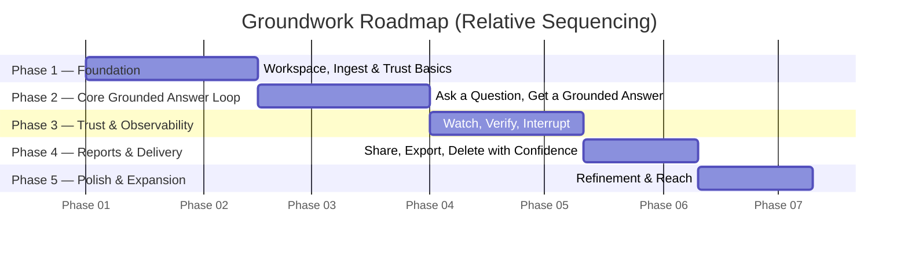

# Roadmap

**Last Updated:** 2026-08-04
**Source:** [[README]], [[features]]

## Vision Statement

Groundwork gets anyone — from a data analyst to a small-business owner with a spreadsheet — a trustworthy, AI-narrated answer from their own data, with every number traceable back to where it came from, delivered in phases that build a working grounded-answer loop first and layer verification, delivery, and polish on top of it.

## Timeline Overview

The chart below shows relative sequencing and rough durations between phases, not calendar commitments — Groundwork is being built by a solo, pre-revenue builder ([[README]]), and phase length depends on available time rather than a fixed schedule.

## Phase 1: Foundation

**Goal:** Establish a private, trustworthy place to upload data — the workspace, ingest, and privacy basics everything else depends on.
**Target:** First build phase.
**Key Outcomes:**
- Users can create an account, create a workspace, and upload their data files
- The platform automatically loads, profiles, and prepares uploaded data for questions
- Users review and confirm inferred types, flagged sensitive columns, and suggested relationships between files before anything is queried
- Users see, before they upload anything, a plain-language explanation of what happens to their data and what may reach the AI model
- Users can trust that deleting a workspace genuinely deletes everything, with proof

**Features Delivered:**

| Feature ID | Feature | Why It Matters |
|---|---|---|
| FEAT-001 | Account Creation & Authentication | So a user's workspaces and data are private to them from day one |
| FEAT-002 | Workspace Creation | Gives users a durable, ownable container for their data before anything else happens |
| FEAT-003 | File Upload (CSV, Excel, Parquet, File-Based OLTP) | Lets users bring data in whatever shape they already have it |
| FEAT-004 | Session-Scoped Engine Provisioning & Ingest | Automatically prepares uploaded data for questions with no setup required |
| FEAT-005 | Data Profiling | Gives every downstream confirmation step real statistics instead of guesses |
| FEAT-006 | Type Inference Review & Confirmation | Lets users catch and fix a wrong type before it causes a wrong answer later |
| FEAT-007 | PII Detection & Flagging at Ingest | Protects likely-sensitive data by default, without requiring users to know what "PII" means |
| FEAT-008 | Multi-File Relationship Inference | Saves users from manually rediscovering the same relationships between files every time |
| FEAT-009 | Candidate Join Review, Accept, Reject | Ensures no relationship between files is ever silently assumed |
| FEAT-011 | Engine Sleep/Wake Lifecycle & Honest Status | Keeps costs low while always telling the user honestly what's happening, never leaving them guessing |
| FEAT-042 | Visible Model-Egress / Audit Log | Makes the platform's privacy claims something a user can verify, not just trust |
| FEAT-044 | Zero-Retention Provider Terms Notice | Tells users plainly, before they upload, what happens to their data |

## Phase 2: Core Grounded Answer Loop

**Goal:** Deliver the product's central value: ask a question in plain English and get an answer that is actually grounded in the uploaded data, with the underlying logic always visible.
**Target:** Second build phase, once Phase 1's workspace and ingest foundation exists.
**Key Outcomes:**
- Users can ask a natural-language question and receive a narrated, chart-illustrated answer
- The answer is always generated from a real query against the user's data, never invented from a summary
- Users who want to see and edit the exact logic behind an answer can do so; users who don't, never have to
- The platform remembers relationships, definitions, and corrections across sessions instead of starting cold every time

**Features Delivered:**

| Feature ID | Feature | Why It Matters |
|---|---|---|
| FEAT-013 | Natural-Language Question → SQL Generation | The foundational mechanism that makes every answer grounded rather than guessed |
| FEAT-014 | SQL Execution & Fact Return | Ensures every answer is backed by results actually computed from the user's data |
| FEAT-015 | Narrative Generation | Turns raw results into a plain-language answer anyone can understand |
| FEAT-016 | Chart Spec Generation | Identifies when a chart will make an answer clearer |
| FEAT-017 | First-Party Chart Rendering | Delivers consistent, interactive charts that match the rest of the product |
| FEAT-018 | SQL Visibility & Inline Editing | Lets a user who wants control see and correct the exact logic behind any answer |
| FEAT-019 | Semantic Layer Storage | Stops every session from starting cold by remembering what's already been learned about the data |
| FEAT-020 | Persistent User Corrections | Makes sure a correction only has to be made once, not repeated every session |

## Phase 3: Trust & Observability

**Goal:** Make the answer-generation process visible and interruptible, and make wrongness detectable rather than hidden — Groundwork's core differentiator against black-box competitors.
**Target:** Third build phase, layered on top of the working answer loop from Phase 2.
**Key Outcomes:**
- Users can watch each step of how an answer is produced, live, instead of waiting on a spinner
- Users can pause, correct, and resume any step of an in-progress answer instead of starting over
- The same question against unchanged data always produces the same answer
- Risky query patterns (like a join that inflates numbers) are caught automatically before a user ever sees a result
- Every query reports what it touched and what it excluded, so silent data loss becomes visible
- Every number a user reads can be clicked to see exactly where it came from

**Features Delivered:**

| Feature ID | Feature | Why It Matters |
|---|---|---|
| FEAT-022 | Resumable DAG Run Engine | Makes every step of generating an answer resumable instead of all-or-nothing |
| FEAT-023 | Live Run Event Stream | Lets users watch what the system is doing in real time |
| FEAT-024 | Halt, Amend, and Resume Any Step | Lets a user fix one wrong step without restarting the whole question |
| FEAT-027 | Determinism Caching | Guarantees a report doesn't silently change on re-run, protecting user trust |
| FEAT-028 | Static SQL Analysis | Catches obviously risky query patterns before a user ever sees a wrong number |
| FEAT-029 | Post-Execution Reconciliation | Surfaces exactly how much data was touched, filtered, or excluded at every step |
| FEAT-030 | Claim-Level Provenance | Lets a user click any number and verify exactly where it came from before repeating it |

## Phase 4: Reports & Delivery

**Goal:** Make finished analysis something users can keep, share, and export — turning a single answer into a durable, deliverable work product.
**Target:** Fourth build phase, once trustworthy answers exist to package.
**Key Outcomes:**
- Every completed answer becomes a durable, shareable report rather than a disappearing chat message
- Users can export a report as a PDF to share with colleagues, or as Excel/CSV to work with the underlying numbers
- Users can open and read a report clearly on their phone before a meeting
- Deleting a workspace genuinely destroys everything derived from it, in one confirmed action

**Features Delivered:**

| Feature ID | Feature | Why It Matters |
|---|---|---|
| FEAT-034 | Reports as First-Class Versioned Objects | Turns a single answer into something durable that can be revisited, shared, and exported |
| FEAT-035 | PDF Export | Gives users a shareable, print-ready version of any report |
| FEAT-036 | Excel/CSV Export | Gives analysts access to the underlying numbers behind a report, not just the narrative |
| FEAT-041 | Mobile-Responsive Report Viewing | Lets users check a report or a number from their phone before a meeting |
| FEAT-043 | One-Workspace-One-Delete Cascade | Makes the platform's deletion promise real and provable, not partial |

## Phase 5: Polish & Expansion

**Goal:** Round out the verification system, deepen collaboration, and extend delivery options beyond the essentials shipped in earlier phases.
**Target:** Fifth build phase, ongoing refinement after the core product is fully usable end to end.
**Key Outcomes:**
- Additional verification checks (independent cross-checks, a second AI review pass, and clarifying questions on ambiguous requests) further reduce the chance of a wrong answer slipping through
- Users can explore alternative analyses from a report without losing the original
- Sharing extends to individual reports and read-only workspace access for colleagues
- More export formats and background notifications round out the day-to-day experience
- Users can see what their usage is costing before it becomes a billing conversation

**Features Delivered:**

| Feature ID | Feature | Why It Matters |
|---|---|---|
| FEAT-010 | Column-Level Exclusion | Gives users fine-grained control over exactly what data a model can see |
| FEAT-012 | Wake-on-Intent Trigger | Shortens perceived wait time by starting the engine before a question is even submitted |
| FEAT-021 | Compositional Follow-Up Questions | Lets users drill deeper into a report without starting over |
| FEAT-025 | Fork-on-Amendment | Lets users explore an alternative analysis without losing the original report |
| FEAT-026 | Durable Notifications | Tells users when something finishes outside the current view, without needing a tab left open |
| FEAT-031 | Shadow Queries | Adds an independent cross-check that catches certain wrong answers even when the query ran cleanly |
| FEAT-032 | Adversarial Second-Pass Review | Adds a second check for whether the generated query actually answers the question asked |
| FEAT-033 | Honest Uncertainty | Has the platform ask for clarification on an ambiguous question instead of guessing |
| FEAT-037 | PowerPoint Export | Lets users present a report directly to a board or leadership without rebuilding it |
| FEAT-038 | Markdown/HTML Export | Lets users embed a report into an internal wiki or document |
| FEAT-039 | JSON Export | Lets other systems consume a report programmatically |
| FEAT-040 | Single Chart Image Export | Lets users grab just one chart to paste elsewhere |
| FEAT-045 | Read-Only Workspace Sharing | Lets a colleague view a workspace's reports without being able to change anything |
| FEAT-046 | Read-Only Report Sharing by ID | Lets a single report be shared outside the workspace's membership |
| FEAT-047 | User-Facing Usage View | Lets users see what's driving their engine, storage, and model usage |

## What's Next

There are no P3 ("Won't Have Now") features in [[features]] at this time — every defined feature is scheduled into one of the five phases above. Future candidates not yet captured as features (per [[README]] Open Questions and Scope) include: export target prioritization beyond what's listed here, run/report retention policy, and fork-tree pruning at scale — these should be added to [[features]] before being scheduled into a future phase.
