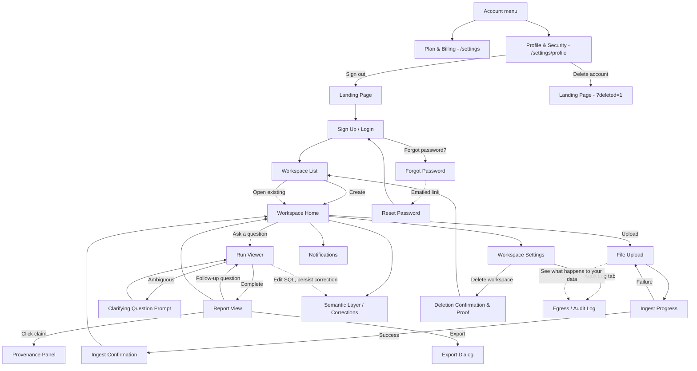

# Screens

**Last Updated:** 2026-08-09
**Source:** [[README]], [[user_personas]], [[features]], [[branding]], [[user_flow]]

**Experience Tier:** `Standard` *(restated from [[branding]] — no Creative Direction/Motion Design/Asset Style Guide sections apply to any screen in this product)*
**Target Platform:** `Web`, with a responsive mobile view *(restated from [[branding]] — desktop-first component vocabulary below, with mobile behavior called out per screen where it diverges)*

## Screen Inventory

| # | Screen Name | File | Route / Path | Platform | Related Features |
|---|---|---|---|---|---|
| 1 | Landing Page | [[screens/01-landing-page\|01-landing-page]] | `/` | Both | FEAT-001 |
| 2 | Sign Up / Login | [[screens/02-sign-up-login\|02-sign-up-login]] | `/signup`, `/login` | Both | FEAT-001 |
| 3 | Workspace List | [[screens/03-workspace-list\|03-workspace-list]] | `/workspaces` | Both | FEAT-002 |
| 4 | Workspace Home | [[screens/04-workspace-home\|04-workspace-home]] | `/workspaces/:id` | Both | FEAT-011, FEAT-012, FEAT-013, FEAT-034, FEAT-048, FEAT-050, FEAT-051 |
| 5 | File Upload | [[screens/05-file-upload\|05-file-upload]] | `/workspaces/:id/upload` | Both | FEAT-003, FEAT-049 |
| 6 | Ingest Progress | [[screens/06-ingest-progress\|06-ingest-progress]] | `/workspaces/:id/ingest/progress` | Both | FEAT-004, FEAT-005 |
| 7 | Ingest Confirmation | [[screens/07-ingest-confirmation\|07-ingest-confirmation]] | `/workspaces/:id/ingest/confirm` | Both (desktop-optimized) | FEAT-006, FEAT-007, FEAT-008, FEAT-009, FEAT-049 |
| 8 | Run Viewer | [[screens/08-run-viewer\|08-run-viewer]] | `/workspaces/:id/runs/:runId` | Both (SQL editing desktop-only) | FEAT-018, FEAT-022, FEAT-023, FEAT-024, FEAT-027, FEAT-028 |
| 9 | Report View | [[screens/09-report-view\|09-report-view]] | `/workspaces/:id/reports/:reportId` | Both | FEAT-015, FEAT-016, FEAT-017, FEAT-029, FEAT-030, FEAT-034, FEAT-041 |
| 10 | Provenance Panel | [[screens/10-provenance-panel\|10-provenance-panel]] | Drawer on Report View (`?claim=:claimId`) | Both | FEAT-030 |
| 11 | Export Dialog | [[screens/11-export-dialog\|11-export-dialog]] | Modal on Report View (`?export=true`) | Both | FEAT-035, FEAT-036, FEAT-037, FEAT-038, FEAT-039, FEAT-040 |
| 12 | Clarifying Question Prompt | [[screens/12-clarifying-question-prompt\|12-clarifying-question-prompt]] | Inline on Run Viewer | Both | FEAT-033 |
| 13 | Workspace Settings | [[screens/13-workspace-settings\|13-workspace-settings]] | `/workspaces/:id/settings` | Both (desktop-optimized) | FEAT-010, FEAT-042, FEAT-045, FEAT-046, FEAT-047 |
| 14 | Deletion Confirmation & Proof | [[screens/14-deletion-confirmation-proof\|14-deletion-confirmation-proof]] | Modal on Settings → `/workspaces/:id/deleted` | Both | FEAT-043 |
| 15 | Semantic Layer / Corrections | [[screens/15-semantic-layer\|15-semantic-layer]] | `/workspaces/:id/semantic-layer` | Both (desktop-optimized) | FEAT-019, FEAT-020 |
| 16 | Notifications | [[screens/16-notifications\|16-notifications]] | `/notifications` | Both | FEAT-026 |
| 17 | Egress / Audit Log | [[screens/17-egress-audit-log\|17-egress-audit-log]] | `/workspaces/:id/audit-log` | Both (desktop-optimized) | FEAT-042, FEAT-044 |
| 18 | Forgot Password | [[screens/18-forgot-password\|18-forgot-password]] | `/forgot-password` | Both | FEAT-001 |
| 19 | Reset Password | [[screens/19-reset-password\|19-reset-password]] | `/reset-password` | Both | FEAT-001 |
| 20 | Profile & Security | [[screens/20-profile-security\|20-profile-security]] | `/settings/profile` | Both | FEAT-052 |

## Navigation Map

## Shared / Common Components

### Engine Status Pill
Used on: [[screens/04-workspace-home|Workspace Home]], [[screens/08-run-viewer|Run Viewer]]
- Status pill component defined in [[branding]] (`sleeping`/`waking`/`ready`/`running`/`verified`/`failed` variants)
- Always paired with a text label, never color alone, per [[branding]] Accessibility
- Colors: `info` (waking/running), `success` (ready/verified), `error` (failed), `surface-secondary`/`text-secondary` (sleeping/neutral)

### Provenance-Linked Number
Used on: [[screens/09-report-view|Report View]], [[screens/10-provenance-panel|Provenance Panel]]
- Inline text styled with the `provenance` token, dotted underline default → solid on hover/focus, `provenance-light` background on hover, per [[branding]] Component Tokens
- Always clickable/keyboard-focusable, opens the Provenance Panel with that specific claim's query and rows

### SQL / Code Block
Used on: [[screens/08-run-viewer|Run Viewer]], [[screens/15-semantic-layer|Semantic Layer / Corrections]]
- Monospace (`code` type token, IBM Plex Mono), `surface-secondary` background when read-only, `surface` background with `primary` border when actively being edited, per [[branding]]
- Column names/inline code use `code-accent` token

### Reconciliation Notice
Used on: [[screens/08-run-viewer|Run Viewer]], [[screens/09-report-view|Report View]]
- `warning`-token banner, always paired with explicit text (e.g., "excluded 31% of rows where region was null") — never a bare icon
- Dismissible but reappears if the user reopens the report from a fresh navigation (it is not a one-time toast)

### Empty State
Used on: [[screens/03-workspace-list|Workspace List]], [[screens/16-notifications|Notifications]], [[screens/04-workspace-home|Workspace Home]] (no reports yet)
- Centered icon (Lucide, `icon-lg` token), `h3` title, `body-small` subtitle in `text-secondary`, primary-button CTA where applicable

### Error State
Used on: all screens with data fetching
- Centered icon (`error` token color), `h3` title "Something went wrong," `body-small` description, primary "Try Again" button (retries the failed request), optional Ghost "Go Back"

### Delete Confirmation Modal
Used on: [[screens/13-workspace-settings|Workspace Settings]] (workspace deletion), [[screens/04-workspace-home|Workspace Home]] (single-dataset deletion, FEAT-048), [[screens/05-file-upload|File Upload]] (duplicate-filename "Replace" choice, FEAT-049 — reuses this pattern since Replace deletes the prior dataset), [[screens/20-profile-security|Profile & Security]] (account deletion, FEAT-052 — the account-scope variant additionally requires typing the account's email, mirroring the workspace-name typing below), any future destructive action
- `Modal` with explicit scope of what will be destroyed spelled out in the body (never a bare "Are you sure?") — for single-dataset deletion (FEAT-048) and Replace (FEAT-049), this includes naming any dependent `Relationship`/`MetricDefinition` **and**, separately, any type override or reviewed PII decision recorded on the dataset's own columns that will be lost and not carried forward; for account deletion (FEAT-052), this includes all workspaces, all data, immediate billing cancellation, and no automatic refund
- Buttons: Ghost "Cancel" and Destructive "Delete" (per [[branding]] Buttons component tokens)
- For irreversible account-scope destruction (workspace deletion and account deletion), a type-to-confirm `TextInput` must match the workspace name (FEAT-043) or account email (FEAT-052) exactly before "Delete" is enabled — a deliberate high-friction confirmation

### Navigation Shell
Used on: all authenticated screens
- **Web (desktop):** Sticky `Navbar` (logo, workspace switcher, notifications bell, account menu) + collapsible `Sidebar` within a workspace (Home, Semantic Layer, Settings)
- **Web (mobile viewport):** `Navbar` collapses to a hamburger-triggered `Drawer` containing the same items; workspace-level `Sidebar` items move into the drawer rather than a separate bottom bar, since the product is report-reading-first on mobile, not tab-navigation-first
- **Account menu (both platforms):** the account-level entry point on every authenticated screen. Items: "Plan & Billing" (`/settings`, the account plan screen) and "Profile & Security" (`/settings/profile`, [[screens/20-profile-security|Profile & Security]]). Sign out is deliberately NOT a menu item — it lives only on the Profile & Security screen, the single sign-out affordance per [[features]] FEAT-052; the menu exists to navigate to where the action lives.

### Upgrade Prompt (Tier Gating)
Used on: [[screens/11-export-dialog|Export Dialog]], [[screens/13-workspace-settings|Workspace Settings]] (sharing, column exclusion), [[screens/04-workspace-home|Workspace Home]] (smart generation, [[features]] FEAT-051)
- Locked options remain visible (never hidden) but styled with reduced-emphasis (`text-secondary`, `icon-sm` lock icon) and a small plan-named `Link` CTA, per [[monetization]]'s tier gate mapping — users always see what they're missing, never a silently absent option
- The CTA names the plan(s) that actually unlock the feature, never a generic "Upgrade": Team-only features (e.g., workspace sharing, FEAT-045) say **"Upgrade to Team"**; Pro/Team features (e.g., column exclusion FEAT-010, report sharing FEAT-046, detailed usage FEAT-047) say **"Upgrade to Pro/Team"**. The copy is per-feature, resolved from [[monetization]]'s Feature Gate Mapping
