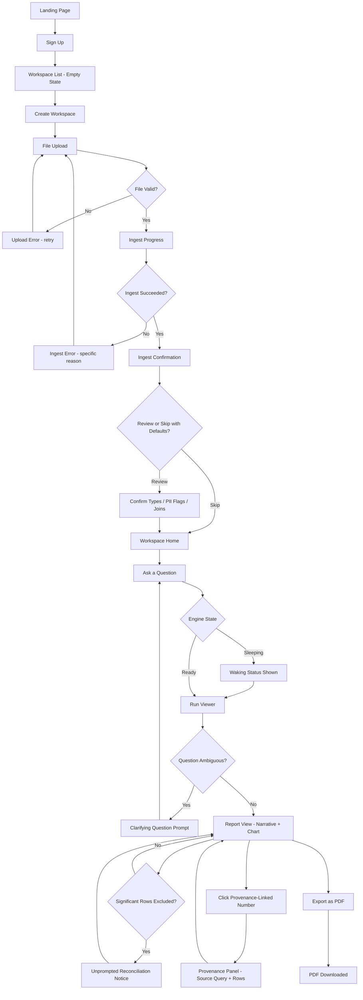
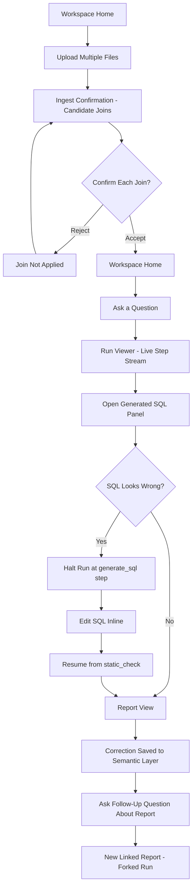
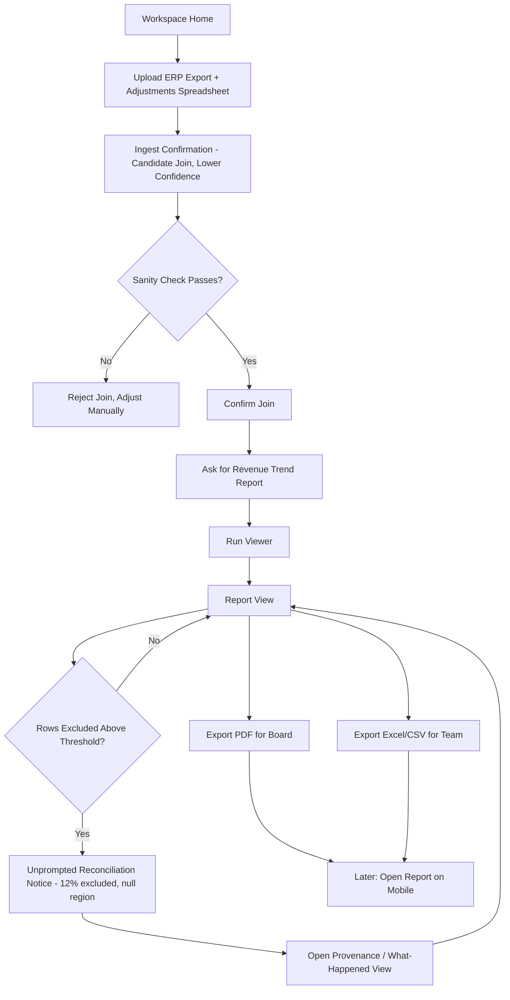
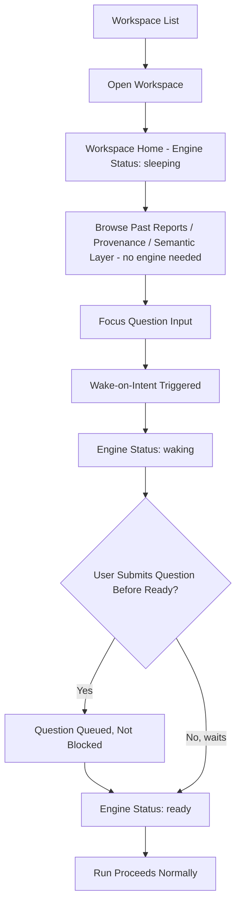
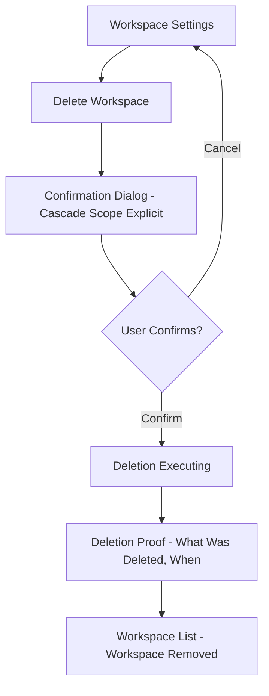
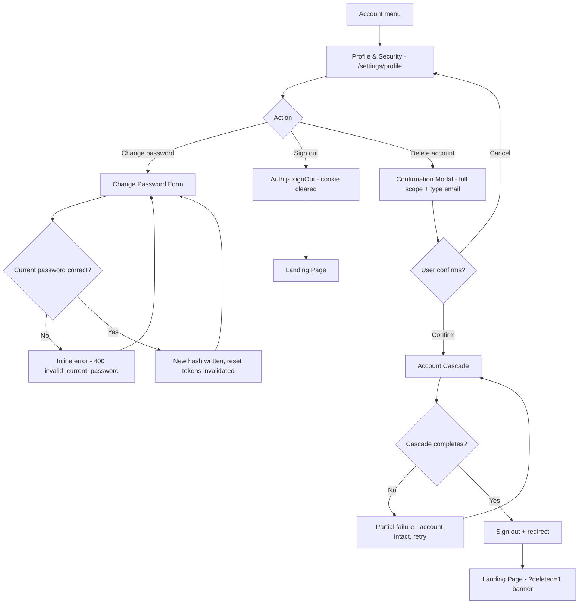

# User Flow

**Last Updated:** 2026-08-09
**Source:** [[README]], [[user_personas]], [[features]], [[architecture]], [[branding]]

Screen names introduced in this document are canonical — [[screens]] formalizes them rather than renaming them.

## Flow Inventory

| # | Flow Name | Persona | Entry Point | Outcome | Related Features |
|---|---|---|---|---|---|
| 1 | First Upload to First Answer | [[user_personas\|Tunde]] (applies to any new user) | Landing Page / Sign Up | User has a verified, exported first answer from their own data | FEAT-001–007, FEAT-011, FEAT-013–017, FEAT-029, FEAT-030, FEAT-033, FEAT-035 |
| 2 | Analyst Deep-Dive & SQL Correction | [[user_personas\|Chidinma]] | Workspace Home | A corrected query becomes a persisted preference, and a follow-up report is generated | FEAT-008, FEAT-009, FEAT-018, FEAT-019, FEAT-020, FEAT-021, FEAT-023, FEAT-024, FEAT-025 |
| 3 | Reconciliation & Board Reporting | [[user_personas\|Ngozi]] | Workspace Home | A reconciled report is exported for two audiences and re-checked on mobile | FEAT-008, FEAT-009, FEAT-029, FEAT-030, FEAT-035, FEAT-036, FEAT-041 |
| 4 | Returning to a Sleeping Workspace | Any user | Workspace List | User's question is answered without ever seeing a blocking wait | FEAT-011, FEAT-012, FEAT-034 |
| 5 | Workspace Deletion | Any user | Workspace Settings | Workspace and all derived state provably destroyed | FEAT-043 |
| 6 | Account Self-Management & Deletion | Any user | Account menu → Profile & Security | Password changed, signed out, and the account with all its workspaces provably deleted | FEAT-001, FEAT-043, FEAT-052 |

## Flow 1: First Upload to First Answer

**Persona:** [[user_personas|Tunde]] — but this is the universal first-run flow for any new user, analyst or not.
**Entry Point:** Landing Page → Sign Up.
**Outcome:** User has asked a real question, received a narrated and charted answer, verified a number via provenance, and exported a PDF.

### Diagram

### Walkthrough

**Happy Path:**
1. User lands on the Landing Page and signs up (FEAT-001).
2. New account has no workspaces; Workspace List shows an empty state with a prominent "Create Workspace" action.
3. User creates a workspace (FEAT-002) and is taken to File Upload.
4. User uploads a spreadsheet file (FEAT-003). Upload progress is shown.
5. System provisions a session-scoped engine and ingests the file, showing an Ingest Progress state (FEAT-004, FEAT-005).
6. Ingest succeeds; system navigates to Ingest Confirmation, showing inferred types, any PII-flagged columns, and (if multiple files were uploaded) candidate joins with confidence scores (FEAT-006, FEAT-007, FEAT-008, FEAT-009).
7. User reviews and confirms (or accepts the sane defaults) and proceeds to Workspace Home.
8. User types a natural-language question in the Ask panel on Workspace Home (FEAT-013).
9. If the engine is sleeping, focusing the question input begins waking it; status is shown honestly as `waking` and the question is queued, not blocked (FEAT-011, FEAT-012).
10. System navigates to the Run Viewer, showing the answer being generated.
11. System generates SQL, executes it, and produces a narrated answer with a chart on the Report View (FEAT-013–017).
12. If a filter excluded a significant share of rows, the report unprompted surfaces that fact (e.g., "excluded 31% of rows where region was null") rather than staying silent (FEAT-029).
13. User clicks a number in the narrative; a Provenance Panel opens showing the exact query and rows behind it (FEAT-030).
14. Satisfied, user exports the report as a PDF (FEAT-035); the file downloads.

**Alternate Path A — Skip Ingest Confirmation with Defaults:**
- At step 6-7, user can choose "Use suggested defaults" instead of reviewing each item individually. System applies inferred types, default PII protections, and does *not* auto-apply any candidate join (joins always require explicit confirmation regardless of the skip choice, per [[features]] FEAT-009). User proceeds directly to Workspace Home.

**Alternate Path B — Ambiguous Question:**
- At step 10-11, if the question is ambiguous (e.g., undefined time period or metric), the system does not guess. It shows a Clarifying Question Prompt instead of a Report View, asking a specific question back to the user (FEAT-033). User answers, and the flow resumes from step 10 with the clarification applied.

**Alternate Path C — Upload Rejected:**
- At step 4, if the file type is unsupported or the file is malformed, an Upload Error state shows a specific, actionable message (not a generic failure). User can retry with a different file without losing their workspace.

**Alternate Path D — Ingest Failure:**
- At step 5, if ingest fails after upload succeeds (e.g., a malformed row, unsupported encoding), an Ingest Error state names the specific reason. User returns to File Upload to correct and re-upload; no partial workspace state is left in an ambiguous condition.

**Alternate Path E — Start from a Suggested Question:**
- At step 8, if the user doesn't know what to ask, the question suggestions strip on Workspace Home ([[features]] FEAT-050) offers 5–10 suggested questions generated from the workspace's datasets and semantic layer. Clicking one fills the Ask input with its text; the user can edit it or submit as-is, and the flow continues from step 9 exactly as if the question had been typed. The strip is served from Postgres alone, so it is available immediately on a `sleeping` workspace without waking the engine.

### States Referenced

| Screen | States |
|---|---|
| Workspace List | Empty, Loaded, Error |
| File Upload | Default, Uploading, Upload Error |
| Ingest Progress | Provisioning, Profiling, Ingest Error |
| Ingest Confirmation | Default (review), Skipped-with-defaults |
| Workspace Home | Engine `sleeping`/`waking`/`ready`, Ask panel focused, Question suggestions strip (visible/empty) |
| Run Viewer | Live step events, Waking, Clarifying Question |
| Report View | Loaded, Reconciliation Notice shown, Provenance Panel open |

## Flow 2: Analyst Deep-Dive & SQL Correction

**Persona:** [[user_personas|Chidinma]].
**Entry Point:** Workspace Home, with multiple files already ingested.
**Outcome:** A wrong join is corrected inline, the correction persists as a semantic-layer preference, and a compositional follow-up produces a new linked report.

### Diagram

### Walkthrough

**Happy Path:**
1. Chidinma is on Workspace Home with three files already ingested (orders, customers, refunds).
2. She reviews candidate joins on Ingest Confirmation, each shown with a confidence score and its basis (matched column names, value overlap %) (FEAT-008, FEAT-009). She confirms two and rejects one that doesn't apply.
3. Back on Workspace Home, she asks a question referencing all three files.
4. The Run Viewer shows each pipeline step live as it happens — profile, plan, generate_sql, static_check, execute, and onward (FEAT-023).
5. She opens the generated SQL, visible inline without an extra click (FEAT-018), and notices the join with `refunds` excludes null refund rows in a way that undercounts a metric.
6. She halts the run at the `generate_sql` step (FEAT-024).
7. She edits the SQL directly in the SQL panel to fix the join condition.
8. She resumes the run from `static_check` forward — steps before her edit are not re-run.
9. The Report View shows the corrected answer.
10. The correction is captured durably and fed into subsequent grounding context (FEAT-019, FEAT-020), so future planning is informed by it. It is not yet actively re-applied by a rule engine — the "corrected version used by default on the third occurrence" behavior is deferred, not shipped (see FEAT-020 AC1).
11. She asks a follow-up question referencing the report she just got ("break this down by month").
12. The system generates a new, linked report using the same fork-on-amendment mechanism, with the original report and run left fully intact (FEAT-021, FEAT-025).

**Alternate Path A — Candidate Join Rejected:**
- At step 2, if Chidinma rejects a candidate join, it is not applied and is never silently reintroduced in a later session with the same files. The relationship is simply absent from the semantic layer until manually added.

**Alternate Path B — SQL Looks Correct, No Edit Needed:**
- At step 5, if the SQL looks correct, she proceeds directly to the Report View without halting the run — the SQL panel is always available for inspection but never forces an interruption.

**Alternate Path C — Engine Lost Mid-Run:**
- At step 4 or 8, if the session engine is lost between steps (e.g., an infrastructure blip), the run does not restart from the beginning. Because every step boundary is persisted, the orchestrator retries the affected step idempotently and resumes from the last completed step once the engine is available again (see [[architecture]]). The Run Viewer shows a brief "reconnecting" state rather than an error. If an `execute` step fails for a content reason (e.g., DuckDB Binder Error from invalid generated SQL), the run fails honestly instead: the Run Viewer shows the Execute failure banner — "The generated query couldn't run" plus the engine's actual reason, with DuckDB's `LINE n:` SQL echo behind an "Engine detail" disclosure — and the recovery path is the edit/refine route in the same view ([[screens/08-run-viewer|Run Viewer]], FEAT-018), never a blind retry affordance, since re-running the same invalid SQL deterministically fails again.

### States Referenced

| Screen | States |
|---|---|
| Ingest Confirmation - Candidate Joins | Pending review, Accepted, Rejected |
| Run Viewer | Live streaming, Halted (user-initiated), Reconnecting (engine loss), Execute failed (banner + edit/refine recovery) |
| SQL Panel | Read-only, Editing, Edited-pending-resume |
| Report View | Loaded, Forked (linked to parent report) |

## Flow 3: Reconciliation & Board Reporting

**Persona:** [[user_personas|Ngozi]].
**Entry Point:** Workspace Home, ahead of a board meeting.
**Outcome:** A reconciled revenue report is exported for two audiences and re-checked from a phone before the meeting.

### Diagram

### Walkthrough

**Happy Path:**
1. Ngozi uploads an ERP revenue export and a manually maintained adjustments spreadsheet into the same workspace (FEAT-003).
2. On Ingest Confirmation, the platform surfaces a candidate join between the two files with a lower confidence score than usual, along with its basis (partial name match, moderate value overlap) (FEAT-008).
3. She sanity-checks the suggested join against what she knows about the two sources and confirms it (FEAT-009).
4. She asks for a revenue trend report (FEAT-013).
5. On the Report View, the system unprompted surfaces that a filter excluded 12% of rows where region was null — she would otherwise have missed this (FEAT-029).
6. She opens the "what happened" / provenance view to understand exactly which rows were excluded and why, without needing to read or write any SQL herself (FEAT-030).
7. Satisfied the number is sound, she exports a clean summary as a PDF for the board (FEAT-035) and the full underlying result set as Excel for her own team's working files (FEAT-036).
8. Ahead of the meeting, she opens the same report from her phone to double-check the headline number, and it renders fully — narrative, chart, and provenance links all usable on the smaller screen (FEAT-041).

**Alternate Path A — Sanity Check Fails:**
- At step 3, if the suggested join doesn't hold up against what Ngozi knows about the two sources, she rejects it. She can still ask questions against each file independently; the system does not force a join to proceed, and reconciliation between the two sources remains a manual step until a join is confirmed or corrected.

**Alternate Path B — No Significant Exclusion:**
- At step 5, if no filter drops a significant share of rows, the Report View shows the answer with a normal (non-warning) reconciliation summary rather than an unprompted notice — the notice only appears when the exclusion crosses the defined threshold, so it doesn't become noise on every report.

### States Referenced

| Screen | States |
|---|---|
| Ingest Confirmation - Candidate Joins | Lower-confidence flagged, Confirmed, Rejected |
| Report View | Loaded, Reconciliation Notice shown, No notice (below threshold) |
| Export Dialog | PDF selected, Excel/CSV selected |
| Report View (Mobile) | Loaded, Provenance Panel (mobile layout) |

## Flow 4: Returning to a Sleeping Workspace

**Persona:** Any user — this is the most common cold-path return per [[architecture]].
**Entry Point:** Workspace List, after the workspace's engine has idled out.
**Outcome:** The user's question is answered normally, with the engine wake handled invisibly and honestly, never as a blocking wait.

### Diagram

### Walkthrough

**Happy Path:**
1. User opens a workspace they haven't touched in a few hours or days, from the Workspace List.
2. Workspace Home shows the engine status honestly as `sleeping` (FEAT-011) — this is never hidden or disguised as a generic loading state.
3. The user can immediately browse past reports, click into provenance, and review the semantic layer — none of this requires the engine to be running (FEAT-034). The question suggestions strip is available here too, generated from Postgres without waking the engine (FEAT-050).
4. When the user focuses the question input to ask something new, wake-on-intent triggers rehydration in the background (FEAT-012).
5. Engine status updates to `waking`, visibly, without blocking any part of the UI.
6. If the user finishes typing and submits a question before the engine is fully ready, the question is queued immediately — never rejected or held on a blocking spinner.
7. Once the engine reports `ready`, the queued question proceeds through the normal Run Viewer flow exactly as in Flow 1.

**Alternate Path A — Unused Wake:**
- At step 4, if the user focuses the input but navigates away without asking anything, the triggered wake is simply left to idle out again on its own schedule — no error, no wasted user-facing state.

**Alternate Path B — Snapshot Unopenable:**
- During wake, if a `.duckdb` warm-cache snapshot exists but fails to open (e.g., a storage-version mismatch), the system falls back to attaching Parquet views automatically and silently, per [[architecture]] — this never surfaces as an error to the user; the only visible effect, if any, is a marginally longer `waking` duration.

### States Referenced

| Screen | States |
|---|---|
| Workspace Home | `sleeping`, `waking`, `ready` |
| Report View | Fully loaded regardless of engine state |

## Flow 5: Workspace Deletion

**Persona:** Any user.
**Entry Point:** Workspace Settings.
**Outcome:** The workspace and every piece of derived state are destroyed in one cascade, with proof shown to the user.

### Diagram

### Walkthrough

**Happy Path:**
1. User navigates to Workspace Settings and selects "Delete Workspace."
2. A Confirmation Dialog makes the cascade scope explicit in plain language — object store contents, semantic layer, reports and conversation history, query caches, and logs, not just "your files" (FEAT-043).
3. User confirms the deletion (a deliberate, hard-to-misclick action given the irreversibility).
4. System executes the deletion as a single cascade.
5. User is shown a Deletion Proof view: what was deleted and the timestamp it happened, satisfying the "provable deletion" requirement rather than a bare "done" message.
6. User is returned to the Workspace List, where the deleted workspace no longer appears.

**Alternate Path A — User Cancels:**
- At step 3, if the user cancels, the dialog closes with no changes made and no partial deletion occurs.

**Alternate Path B — Deletion Fails Partway:**
- At step 4, if any part of the cascade fails to complete, the system does not show a false Deletion Proof. It retries the cascade automatically; if it cannot complete, it shows an explicit in-progress or failed state rather than silently claiming success — the product's honesty principle applies to deletion exactly as it does to engine status and query reconciliation.

### States Referenced

| Screen | States |
|---|---|
| Confirmation Dialog | Default, Confirming |
| Deletion Proof | Success (with timestamp and scope), In-progress, Failed-with-retry |

## Flow 6: Account Self-Management & Deletion

**Persona:** Any user.
**Entry Point:** Navigation Shell → account menu → "Profile & Security" (`/settings/profile`).
**Outcome:** The user changes their password, signs out, or deletes their account with everything provably gone.

### Diagram

### Walkthrough

**Happy Path:**
1. User opens the account menu from the Navigation Shell and selects "Profile & Security" (FEAT-052).
2. The screen shows the account email and display name (read-only) and three actions.
3. **Change password:** user enters the current password, a new password, and a confirmation. On submit, the server verifies the current password, writes the new hash, and invalidates any outstanding reset tokens. The form clears with an inline "Password updated" confirmation. Existing sessions are not revoked (JWT strategy) — the screen does not claim otherwise.
4. **Sign out:** user taps Sign out; the existing Auth.js `signOut` clears the session cookie and the user lands on the Landing Page. This is the product's single sign-out affordance.
5. **Delete account:** user taps Delete account; the shared Delete Confirmation Modal opens stating the full scope — all workspaces and their data destroyed, billing cancelled immediately, no automatic refund — and requires typing the account email to enable Delete.
6. User confirms; the account cascade runs: every owned workspace is deleted via the FEAT-043 cascade (each leaving a surviving `DeletionRecord`), then the account's memberships, notifications, reset tokens, audit entries, and billing events are removed, the Stripe subscription is cancelled immediately and the Stripe customer deleted, and finally the `users` row is deleted.
7. On success, the browser is signed out and redirected to the Landing Page with `?deleted=1`, showing the "Your account and all its data have been deleted" banner.
8. Re-authenticating with the deleted account's credentials fails with the generic invalid-credentials response (non-enumerating).

**Alternate Path A — Wrong Current Password:**
- At step 3, if the current password is wrong, the server returns 400 `invalid_current_password` and the screen shows an inline error; the user stays on the form. Deliberately not 401 — a 401 would be misread by the client as session expiry and routed to the login gate.

**Alternate Path B — Deletion Fails Partway:**
- At step 6, if any step of the account cascade fails, the system does not show a false success. It names the failed step and the completed steps, leaves the account fully intact and signed in, and offers a retry (every step is idempotent, mirroring Flow 5 Alternate Path B). The `users` row is only deleted after every prior step succeeds.

**Alternate Path C — Stale Session After Deletion:**
- A browser tab that still holds a decryptable session cookie from a deleted account (e.g., reopened after deletion) passes the optimistic web proxy but fails closed on every API request with 401/404 (user not found) — the proxy is not the authorization boundary.

### States Referenced

| Screen | States |
|---|---|
| Profile & Security | Loaded, Password Submitting, Password Updated, Password Error, Confirming (delete), Ready to Confirm, Deleting, Deletion Partial/Failed, Offline |
| Landing Page | Account Deleted (`?deleted=1` banner) |

## Global Flows

### Authentication Gate

- Any workspace or report URL accessed while unauthenticated → redirect to Sign Up / Login, then back to the originally requested screen after successful authentication.
- A shared report link (read-only, [[features]] FEAT-046) does not require authentication to view — access is scoped to possession of the link, not account identity, consistent with [[README]]'s v1 read-only sharing model.
- Sign out is the single Auth.js `signOut` affordance on the Profile & Security screen (Flow 6, [[features]] FEAT-052); it clears the session cookie and returns the user to the Landing Page.
- After account deletion (Flow 6), the session cookie is cleared and the user lands on the Landing Page with the `?deleted=1` confirmation. A deleted account cannot re-authenticate — login returns the same generic invalid-credentials response it returns for a nonexistent account, preserving the account-existence non-enumeration rule.

### Engine & Run Error Recovery

- Any query execution failure due to transient engine loss is retried idempotently and transparently before ever surfacing to the user (see [[architecture]], Flow 2 Alternate Path C).
- A genuine, non-recoverable run failure surfaces a retry affordance scoped to that specific run — the workspace, its data, and all prior reports remain visibly untouched, never implying broader data loss from a single failed question.
- A `.duckdb` snapshot failing to open never surfaces as a user-facing error (Flow 4 Alternate Path B) — it is an internal fallback, not a failure state.

### Honesty-First Status Display

- Engine state (`sleeping`/`waking`/`ready`), run state, and reconciliation results are never hidden behind a generic spinner — every long-running or state-changing operation shows its real status, per [[branding]]'s status pill components.
- No flow in this product shows a "session expired" warning implying required user action when nothing is actually lost — sleeping workspaces remain fully browsable (Flow 4) and are never presented as something the user must manage.

### Mobile Adaptation

- Ingest and SQL-editing flows (Flow 1 steps 4-7, Flow 2 steps 5-8) are desktop-oriented but remain accessible, not broken, on a mobile viewport.
- Report viewing, provenance drill-down, and status displays are fully first-class on mobile in every flow, per [[branding]] and [[features]] FEAT-041.
